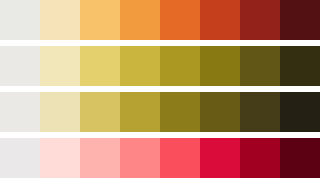
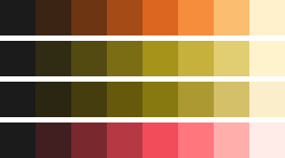
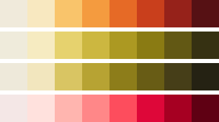
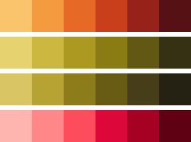
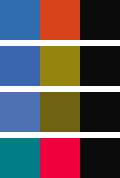
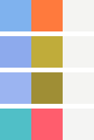
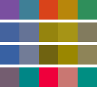
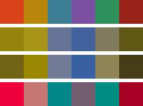

# Colour accessibility (R10)

Generated by `scripts/check_color_access.py` on 2026-11-15 from the colours in `web/src`. Re-run it after any colour change; it reads the source files directly.

Method: colour-vision deficiency simulated with Machado, Oliveira & Fernandes (2009) at severity 1.0 in linear sRGB; CIELAB (D65) L*; colour difference CIEDE2000 (verified against Sharma et al. 2005 test pairs); contrast per WCAG 2.x. Thresholds: sequential ramps need monotonic L* and adjacent ΔE2000 ≥ 5 in every view; categorical palettes need every pair ΔE2000 ≥ 10 in every view; text needs 4.5:1 (WCAG 1.4.3 AA), series and accent colours used as graphics need 3:1 (WCAG 1.4.11).

## Failing items

- **Satellite colours (globe, fleet, drift clocks)** (`lib/sats.ts SAT_COLORS`): minimum ΔE2000 5.4 under deuteranopia (closest pair Suomi-NPP / NOAA-20). Proposed replacement: separate the clashing pair in lightness (not only hue), or take the pair from a CVD-safe categorical set such as Okabe–Ito (#E69F00, #56B4E9, #009E73, #0072B2, #D55E00, #CC79A7). UI not changed.
- **Method chart hues** (`Method.tsx HUES`): minimum ΔE2000 5.4 under deuteranopia (closest pair #d9431a / #b8860b). Proposed replacement: separate the clashing pair in lightness (not only hue), or take the pair from a CVD-safe categorical set such as Okabe–Ito (#E69F00, #56B4E9, #009E73, #0072B2, #D55E00, #CC79A7). UI not changed.

Note (not a failure): `lib/brief.ts` says its HEX array mirrors `--seq-0..7`, but steps 0, 1, 2, 3, 4, 5, 6, 7 differ from the light tokens. Both pass; consider syncing them.

## Ramps and palettes

ΔE columns: sequential = minimum between adjacent steps; categorical = minimum over all pairs.

| Palette | Type | Steps | L* monotonic (N/D/P/T) | ΔE normal | ΔE deutan | ΔE protan | ΔE tritan | Result | Strip |
|---|---|---|---|---|---|---|---|---|---|
| Ember ramp, light (calendar, season rings) (`tokens.css --seq-0..7`) | sequential | 8 | yes/yes/yes/yes | 12.0 | 7.1 | 9.4 | 10.5 | PASS | [png](figures/ramp_ember_light.png) |
| Ember ramp, dark (calendar, season rings) (`tokens.css dark --seq-0..7`) | sequential | 8 | yes/yes/yes/yes | 11.0 | 8.4 | 10.5 | 9.1 | PASS | [png](figures/ramp_ember_dark.png) |
| Brief export ramp (standalone HTML) (`lib/brief.ts HEX`) | sequential | 8 | yes/yes/yes/yes | 8.1 | 7.2 | 8.2 | 6.1 | PASS | [png](figures/ramp_brief.png) |
| Globe FRP ramp (`FireGlobe.tsx RAMP`) | sequential | 6 | yes/yes/yes/yes | 12.3 | 7.2 | 9.5 | 10.8 | PASS | [png](figures/ramp_globe.png) |
| Raw vs harmonized series, light (`tokens.css --c-raw / --ember / --ink`) | categorical | 3 | n/a | 37.3 | 36.5 | 35.4 | 38.5 | PASS | [png](figures/ramp_series_light.png) |
| Raw vs harmonized series, dark (`tokens.css dark --c-raw / --ember / --ink`) | categorical | 3 | n/a | 26.8 | 28.1 | 25.3 | 27.5 | PASS | [png](figures/ramp_series_dark.png) |
| Satellite colours (globe, fleet, drift clocks) (`lib/sats.ts SAT_COLORS`) | categorical | 5 | n/a | 25.8 | 5.4 | 12.2 | 5.5 | FAIL | [png](figures/ramp_satellites.png) |
| Method chart hues (`Method.tsx HUES`) | categorical | 6 | n/a | 17.1 | 5.4 | 12.2 | 5.5 | FAIL | [png](figures/ramp_method_hues.png) |
| AOI map: cells vs selection box (`AoiMap.tsx`) | categorical | 2 | n/a | 50.9 | 43.5 | 38.0 | 59.1 | PASS | [png](figures/ramp_aoi_map.png) |

Each strip shows four rows: normal, deuteranopia, protanopia, tritanopia.

**Ember ramp, light (calendar, season rings)** — `#e9e9e5`, `#f6e3b8`, `#f7c26a`, `#f29a3e`, `#e46a26`, `#c63f1c`, `#93221a`, `#531114`; L* 92, 91, 82, 71, 59, 47, 33, 17

**Ember ramp, dark (calendar, season rings)** — `#1b1b1b`, `#3b2413`, `#6e3512`, `#a54c16`, `#dc661f`, `#f68d3c`, `#fbbd70`, `#fff1cc`; L* 10, 17, 29, 43, 57, 69, 81, 95

**Brief export ramp (standalone HTML)** — `#f0eadb`, `#f8e8c0`, `#f9c46b`, `#f49b3f`, `#e66a26`, `#c93f1c`, `#96221a`, `#561114`; L* 93, 92, 82, 72, 59, 47, 33, 18

**Globe FRP ramp** — `#f9c46b`, `#f49b3f`, `#e66a26`, `#c93f1c`, `#96221a`, `#561114`; L* 82, 72, 59, 47, 33, 18

**Raw vs harmonized series, light** — `#2f6db0`, `#d9431a`, `#0b0b0b`; L* 45, 51, 3

**Raw vs harmonized series, dark** — `#7fb2ee`, `#ff7a3d`, `#f4f4f2`; L* 71, 66, 96

**Satellite colours (globe, fleet, drift clocks)** — `#7a4fa0`, `#3f7f96`, `#d9431a`, `#b8860b`, `#2f8f5b`; L* 42, 50, 51, 59, 53

**Method chart hues** — `#d9431a`, `#b8860b`, `#3f7f96`, `#7a4fa0`, `#2f8f5b`, `#96221a`; L* 51, 59, 50, 42, 53, 33

**AOI map: cells vs selection box** — `#3f7f96`, `#d9431a`; L* 50, 51

## Text and accent contrast

| Theme | Foreground | Background | Colours | Ratio | Needs | Result |
|---|---|---|---|---|---|---|
| light | `--text-primary` | `--bg` | #0b0b0b on #f4f4f2 | 17.87:1 | 4.5:1 | PASS |
| light | `--text-primary` | `--surface` | #0b0b0b on #ffffff | 19.68:1 | 4.5:1 | PASS |
| light | `--text-primary` | `--surface-alt` | #0b0b0b on #eaeae7 | 16.33:1 | 4.5:1 | PASS |
| light | `--text-secondary` | `--bg` | #3c3c3a on #f4f4f2 | 10.04:1 | 4.5:1 | PASS |
| light | `--text-secondary` | `--surface` | #3c3c3a on #ffffff | 11.06:1 | 4.5:1 | PASS |
| light | `--text-secondary` | `--surface-alt` | #3c3c3a on #eaeae7 | 9.17:1 | 4.5:1 | PASS |
| light | `--text-muted` | `--bg` | #6a6a66 on #f4f4f2 | 4.93:1 | 4.5:1 | PASS |
| light | `--text-muted` | `--surface` | #6a6a66 on #ffffff | 5.43:1 | 4.5:1 | PASS |
| light | `--text-muted` | `--surface-alt` | #6a6a66 on #eaeae7 | 4.51:1 | 4.5:1 | PASS |
| light | `--red` | `--bg` | #d71921 on #f4f4f2 | 4.71:1 | 3:1 | PASS |
| light | `--red` | `--surface` | #d71921 on #ffffff | 5.18:1 | 3:1 | PASS |
| light | `--ember` | `--bg` | #d9431a on #f4f4f2 | 4.00:1 | 3:1 | PASS |
| light | `--ember` | `--surface` | #d9431a on #ffffff | 4.40:1 | 3:1 | PASS |
| light | `--c-raw` | `--bg` | #2f6db0 on #f4f4f2 | 4.85:1 | 3:1 | PASS |
| light | `--c-raw` | `--surface` | #2f6db0 on #ffffff | 5.34:1 | 3:1 | PASS |
| light | `--on-ink` | `--ink` | #f4f4f2 on #0b0b0b | 17.87:1 | 4.5:1 | PASS |
| dark | `--text-primary` | `--bg` | #f4f4f2 on #0b0b0b | 17.87:1 | 4.5:1 | PASS |
| dark | `--text-primary` | `--surface` | #f4f4f2 on #151515 | 16.58:1 | 4.5:1 | PASS |
| dark | `--text-primary` | `--surface-alt` | #f4f4f2 on #202020 | 14.80:1 | 4.5:1 | PASS |
| dark | `--text-secondary` | `--bg` | #c8c8c4 on #0b0b0b | 11.73:1 | 4.5:1 | PASS |
| dark | `--text-secondary` | `--surface` | #c8c8c4 on #151515 | 10.88:1 | 4.5:1 | PASS |
| dark | `--text-secondary` | `--surface-alt` | #c8c8c4 on #202020 | 9.71:1 | 4.5:1 | PASS |
| dark | `--text-muted` | `--bg` | #94948f on #0b0b0b | 6.46:1 | 4.5:1 | PASS |
| dark | `--text-muted` | `--surface` | #94948f on #151515 | 5.99:1 | 4.5:1 | PASS |
| dark | `--text-muted` | `--surface-alt` | #94948f on #202020 | 5.35:1 | 4.5:1 | PASS |
| dark | `--red` | `--bg` | #ff3038 on #0b0b0b | 5.37:1 | 3:1 | PASS |
| dark | `--red` | `--surface` | #ff3038 on #151515 | 4.98:1 | 3:1 | PASS |
| dark | `--ember` | `--bg` | #ff7a3d on #0b0b0b | 7.59:1 | 3:1 | PASS |
| dark | `--ember` | `--surface` | #ff7a3d on #151515 | 7.05:1 | 3:1 | PASS |
| dark | `--c-raw` | `--bg` | #7fb2ee on #0b0b0b | 8.91:1 | 3:1 | PASS |
| dark | `--c-raw` | `--surface` | #7fb2ee on #151515 | 8.27:1 | 3:1 | PASS |
| dark | `--on-ink` | `--ink` | #0b0b0b on #f4f4f2 | 17.87:1 | 4.5:1 | PASS |
